<div align="center">

# MarginLeak: Find the Money Your Business Is Losing

<p align="center">
  
</p>

<p align="center">
  <a href="https://readme-typing-svg.demolab.com">
    
  </a>
</p>

[](https://marginleak.onrender.com/)
[](https://dev.to/agent_sessions/marginleak-autonomous-accounts-payable-ai-auditor-3800ko)
[-4338ca?style=for-the-badge&logo=target&logoColor=white)](https://tinker-docs.thinkingmachines.ai)
[](https://github.com/automl/TabPFN)
[](LICENSE)

---

**Built for the [Hacktoberfest 2026 Open-Source AI Challenge Week 2: Side Hustle](https://dev.to/challenges/hacktoberfest-week2-2026-10-12)**

</div>

---

## ⚡ Quick Navigation

* [The Problem: Unnoticed Accounts-Payable Leakage](#-the-problem-unnoticed-accounts-payable-leakage)
* [Key Differentiators & Principles](#-key-differentiators--principles)
* [Interactive Visual Workflow](#-interactive-visual-workflow)
* [Open-Weight Fine-Tuning with Tinker](#-open-weight-fine-tuning-with-thinking-machines-tinker)
* [TabPFN Supplier Risk & Recovery Scoring](#-tabpfn-supplier-risk--recovery-scoring)
* [Full System Architecture](#-full-system-architecture)
* [Multi-Tenant Security & Tenancy](#-multi-tenant-security--tenancy)
* [Local Quickstart & Reproduction](#-local-quickstart--reproduction)
* [API Specification](#-api-specification)
* [Production Deployment on Render](#-production-deployment-on-render)
* [Verified DevRelay AI Session](#-verified-devrelay-ai-agent-session)
* [License](#-license)

---

## 🛑 The Problem: Unnoticed Accounts-Payable Leakage

Small e-commerce operators, independent distributors, and recurring B2B buyers purchase components from dozens of suppliers. Every month, accounts-payable teams process hundreds of raw line items across fragmented formats.

Because accounting personnel lack the time to manually cross-check every line item against purchase orders and past pricing, **accounts-payable leakage silently drains 2% to 8% of net business margins**:

* 📈 **Silent Unit Price Creep**: A supplier quietly hikes a unit price from **$14.50 to $16.20** (+11.7%). Across a 300-unit batch, that is **$510.00 directly lost from net profit**.
* 📦 **Quantity Over-Billing**: An invoice bills for **150 units** when the approved Purchase Order (PO) only authorized **100 units**. That represents **hundreds of dollars of unauthorized inventory exposure**.
* 🔄 **Duplicate Line Items & Invoices**: The same line item is billed twice across overlapping invoices, or an entire invoice is resubmitted under a slightly altered invoice number.
* 🔀 **Semantic Description Chaos**: Traditional spreadsheet `VLOOKUP` or SQL joins fail completely because supplier descriptions never match purchase order catalog names (*"Type C Multi-Port Hub 7P"* vs. *"7-in-1 USB-C Dock Space Gray"*).

**MarginLeak** acts as an autonomous AI accounts-payable auditor that catches discrepancies **before** a business pays its bills, showing the business owner:
1. **What looks wrong** (severity & discrepancy category)
2. **How much money is at stake** (down to the cent)
3. **The exact calculation formula and source document evidence backing the finding**
4. **An automated one-click supplier credit-memo dispute letter**

---

## 🛡️ Key Differentiators & Principles

| Capability | How Legacy Tools Fail | How MarginLeak Solves It |
| :--- | :--- | :--- |
| **Arithmetic Integrity** | General LLMs calculate totals with hallucinations and floating-point math errors. | **The LLM never calculates money.** Open-weight models normalize messy descriptions, while strict Python `decimal.Decimal` calculates exact price/quantity variances. |
| **Evidence Grounding** | Black-box assertions with no verifiable proof. | Every finding cites the **exact invoice page number, raw text block, and bounding-box coordinates**. |
| **Fuzzy Semantic Matching** | Rule-based string joins fail on synonyms and packaging shorthand. | Fine-tuned **Qwen3-8B with Tinker LoRA** + RapidFuzz extracts canonical product identities, pack sizes, and units without false merges. |
| **Supplier Overbilling Risk** | Static historical averages fail on small vendor datasets. | **TabPFN 2.0** Bayesian tabular modeling analyzes supplier history to compute overbilling risk tiers and dispute win probabilities. |
| **Continuous Learning Loop** | Mistakes repeat every billing cycle. | Confirmed human corrections are saved as **tenant-isolated supplier aliases**, automatically teaching the system vendor naming conventions. |
| **Remediation Speed** | Drafting dispute emails takes 15–30 minutes per supplier. | **One-Click Dispute Generator** creates an itemized, polite, and legally grounded supplier credit memo request with clipboard copy and `mailto:` pre-filling. |

---

## 🔄 Interactive Visual Workflow

```mermaid
sequenceDiagram
    autonumber
    actor Auditor as Business Owner / Auditor
    participant Web as React 19 Dashboard
    participant API as FastAPI Backend
    participant Doc as PyMuPDF & Pandas Extractor
    participant AI as Tinker LoRA (Qwen3-8B)
    participant Math as Decimal Financial Engine
    participant PFN as TabPFN Bayesian Classifier
    participant DB as Isolated Tenancy DB

    Auditor->>Web: Uploads Supplier Invoice PDF & PO Spreadsheet
    Web->>API: POST /documents/invoices & /purchase-orders/import
    API->>Doc: Extract selectable text, bounding boxes & PO lines
    Doc-->>API: Extracted line items & page coordinates

    rect rgb(20, 25, 45)
        note right of API: Language Normalization (AI Layer)
        API->>AI: Normalize raw supplier descriptions
        AI-->>API: Canonical attributes, pack size & units
    end

    rect rgb(20, 45, 30)
        note right of API: Deterministic Reconciliation (Zero LLM Math)
        API->>Math: Compute Price Variance, Quantity Overage & Duplicates
        Math-->>API: Exact variance amounts, formulas & findings
    end

    rect rgb(45, 30, 40)
        note right of API: Empirical Risk Intelligence
        API->>PFN: Query supplier historical profile
        PFN-->>API: Overbilling Risk (Elevated) + Dispute Win Rate (89%)
    end

    API->>DB: Save reconciliation & audit-anchored findings
    API-->>Web: Reconciliation summary & visual evidence cards
    Web-->>Auditor: Render discrepancies with page bounding boxes

    opt Dispute Resolution
        Auditor->>Web: Click "Generate Dispute Letter"
        Web-->>Auditor: Pre-filled email draft with itemized proofs & mailto action
    end
```



---

## 🧠 Open-Weight Fine-Tuning with Thinking Machines Tinker

For the Hacktoberfest **Best Use of Tinker** track, MarginLeak fine-tunes an open-weight foundation model (`Qwen/Qwen3-8B`) using **Thinking Machines' Tinker API** with Low-Rank Adaptation (LoRA rank 16, alpha 32).

### The Task: Canonical Line-Item Normalization
Standardizes chaotic vendor descriptions into strict canonical JSON containing product identity, pack quantity, pack unit, size, and uncertainty flags:

```json
// Raw Input:
{ "supplier_description": "CRG-055 HY BLK TONER 7.6K CAP 1PK", "supplier_sku": "CRG055HBK" }

// Canonical Output:
{
  "canonical_description": "Canon 055H High-Yield Black Toner Cartridge, 7600 page yield",
  "brand": "Canon",
  "category": "Office Supplies / Toner",
  "pack_quantity": 1,
  "pack_unit": "pack",
  "attributes": ["high-yield", "black", "7600-pages"],
  "uncertainty_flag": false
}
```

<details>
<summary><b>🔍 View Real Tinker LoRA Training Implementation Details</b></summary>

The trainer in [`tinker_experiment/train_tinker_lora.py`](file:///c:/Users/divya/DataDrive/Study/Projects/Hacktoberfest/tinker_experiment/train_tinker_lora.py) utilizes the genuine Tinker SDK:
* Initializes `create_lora_training_client(base_model="Qwen/Qwen3-8B", rank=16)`
* Constructs training datums with tokenized prompt inputs and supervised target completions
* Executes real `forward_backward` gradient computation and AdamW optimizer steps
* Saves trained LoRA sampler weights and exports checkpoint metadata to `checkpoint_metadata.json`
* Quantitative Loss Trajectory:
  - **Epoch 1 Loss**: `2892.88`
  - **Epoch 2 Loss**: `2379.41` (-17.7% loss reduction)

```bash
# Run genuine Tinker LoRA training:
export TINKER_API_KEY="your_api_key_here"
python tinker_experiment/train_tinker_lora.py --epochs 2 --lora-rank 16
```
</details>

<details>
<summary><b>📊 Held-Out Benchmark Runner (`run_benchmark.py`)</b></summary>

The benchmark suite in [`tinker_experiment/run_benchmark.py`](file:///c:/Users/divya/DataDrive/Study/Projects/Hacktoberfest/tinker_experiment/run_benchmark.py) evaluates extraction accuracy, pack-quantity precision, and token similarity on a 30-case held-out benchmark dataset.

To run the deterministic baseline evaluation:
```bash
python tinker_experiment/run_benchmark.py
```
</details>

---

## 📈 TabPFN Supplier Risk & Recovery Scoring

MarginLeak integrates **TabPFN 2.0** (Prior-data Fitted Networks for tabular data) in [`backend/app/engine/supplier_risk.py`](file:///c:/Users/divya/DataDrive/Study/Projects/Hacktoberfest/backend/app/engine/supplier_risk.py):

* **Prior-Data Tabular Classifier**: Trained offline on millions of synthetic tabular datasets; performs instant Bayesian inference on small sample sizes without requiring hyperparameter tuning.
* **Feature Extraction**: Computes supplier invoice history, frequency of past discrepancies, median overcharge margins, and confirmed dispute outcomes.
* **Risk Categorization**: Classifies vendors into `low`, `moderate`, or `elevated` overbilling risk tiers.
* **Dispute Win Probability**: Projects the likelihood of recovering credit based on historical supplier concession patterns.
* **Zero-Dependency Fallback**: Automatically degrades to a statistical median baseline when TabPFN or model keys are absent.

---

## 🏗️ Full System Architecture

```
┌─────────────────────────────────────────────────────────────────────────────┐
│                            MARGINLEAK ARCHITECTURE                          │
├─────────────────────────────────────────────────────────────────────────────┤
│                                                                             │
│  [Invoice PDF] ──> PyMuPDF Extractor ──> Raw Line Items + Bounding Boxes    │
│  [PO Spreadsheet] ─> Pandas / OpenPyXL ─> Authorized PO Line Items          │
│                                │                                            │
│                                ▼                                            │
│   ┌─────────────────────────────────────────────────────────────────────┐   │
│   │               CANONICAL NORMALIZATION & MATCHING                    │   │
│   │  • Thinking Machines Tinker LoRA (Qwen3-8B): Canonical attributes   │   │
│   │  • Deterministic Fallback Normalizer: Rule-based regex tokenization │   │
│   │  • RapidFuzz Matcher: Token-sort ratio, SKU alignment, confidence   │   │
│   └─────────────────────────────────────────────────────────────────────┘   │
│                                │                                            │
│                                ▼                                            │
│   ┌─────────────────────────────────────────────────────────────────────┐   │
│   │            DETERMINISTIC FINANCIAL RECONCILIATION ENGINE            │   │
│   │  • Exact Python decimal.Decimal precision (zero floating-point err) │   │
│   │  • Price Variance: (Invoice Price - PO Price) × Invoiced Qty        │   │
│   │  • Quantity Variance: (Invoiced Qty - PO Qty) × PO Unit Price       │   │
│   │  • Duplicate Line Detection & Historical Median Price Tracking      │   │
│   └─────────────────────────────────────────────────────────────────────┘   │
│                                │                                            │
│                                ▼                                            │
│   ┌─────────────────────────────────────────────────────────────────────┐   │
│   │         TABPFN SUPPLIER RISK & DISPUTE RECOVERY INTELLIGENCE         │   │
│   │  • TabPFN 2.0 Bayesian Tabular Classifier: Supplier Overbilling Risk│   │
│   │  • Dispute Recovery Probability: Historical win rate estimation     │   │
│   └─────────────────────────────────────────────────────────────────────┘   │
│                                │                                            │
│                                ▼                                            │
│   ┌─────────────────────────────────────────────────────────────────────┐   │
│   │                      OUTPUT & REMEDIATION LAYER                     │   │
│   │  • Interactive Audit Dashboard (React 19 + TypeScript + Vite)       │   │
│   │  • PDF Source Snippet & Page Citation                               │   │
│   │  • One-Click Credit-Memo Dispute Generator (Formatted text + mailto)│   │
│   │  • Human-in-the-Loop Feedback: Confirmed corrections saved as aliases│  │
│   └─────────────────────────────────────────────────────────────────────┘   │
└─────────────────────────────────────────────────────────────────────────────┘
```

---

## 🔐 Multi-Tenant Security & Tenancy

* **Dual-Mode JWT Verification**:
  - Dynamically inspects token headers to support modern Supabase asymmetric **`ES256` Elliptic Curve tokens** via Supabase Auth API verification (`/auth/v1/user`).
  - Retains high-speed local **`HS256` HMAC verification** when symmetric secrets are configured.
* **In-Memory TTL Caching**:
  - Eliminates extraneous network latency by caching validated user claims in `_verified_token_cache`.
* **Row-Level Workspace Tenancy**:
  - All database models (`Invoice`, `PurchaseOrder`, `Reconciliation`, `Finding`) are foreign-keyed to `workspace_id`.
  - Authenticated users cannot inspect or modify records belonging to other workspaces (returns strict `404 Not Found`).
* **Upload Sandboxing**:
  - Temporary files use cryptographically random UUID keys; path traversal attempts (`../`) are detected and blocked before file access.

---

## 💻 Local Quickstart & Reproduction

### Prerequisites
* Python 3.12+ (or 3.14)
* Node.js 20+

### 1. Clone & Set Up Backend
```bash
git clone https://github.com/inddivyansh/MarginLeak.git
cd MarginLeak

# Create and activate virtual environment
python -m venv .venv
# On Windows PowerShell:
.\.venv\Scripts\Activate.ps1
# On Linux/macOS:
source .venv/bin/activate

# Install dependencies (includes FastAPI, SQLAlchemy, PyMuPDF, PyJWT, Cryptography)
pip install -r backend/requirements.txt

# Run the 11-test security and reconciliation test suite
python -m pytest backend/tests
```

### 2. Set Up Frontend
```bash
cd frontend
npm install
npm run build
cd ..
```

### 3. Launch the Application
```bash
# Start FastAPI (serves both API endpoints and the built React frontend)
uvicorn backend.app.main:app --host 127.0.0.1 --port 8000 --reload
```
Open **[http://127.0.0.1:8000](http://127.0.0.1:8000)** in your browser!

Click **"Load Demo Scenario"** in the top bar to immediately inspect a live reconciliation with intentional price, quantity, historical-price, and duplicate-line discrepancies.

---

## 📡 API Specification

All routes are mounted under `/api/v1` and protected via Supabase Bearer access tokens:

| Module | Method & Route | Description |
| :--- | :--- | :--- |
| **Auth** | `GET /auth/config` | Returns public Supabase project URL and anon key. |
| **Auth** | `GET /auth/me` | Validates session token and returns active workspace info. |
| **Documents** | `POST /documents/invoices` | Uploads and parses supplier invoice PDF with PyMuPDF. |
| **Documents** | `POST /purchase-orders/import` | Uploads PO spreadsheet and detects columns. |
| **Documents** | `POST /purchase-orders/confirm-import` | Confirms mapped PO column schema and creates lines. |
| **Reconcile** | `POST /reconciliations` | Triggers deterministic matching and variance analysis. |
| **Reconcile** | `GET /reconciliations/{id}` | Fetches detailed findings, matches, and exposure totals. |
| **Findings** | `PATCH /findings/{id}` | Updates finding review status (`confirmed`, `dismissed`, `resolved`). |
| **Actions** | `GET /findings/{id}/dispute-draft` | Generates formatted supplier credit-memo dispute letter. |
| **Actions** | `GET /reports/{id}.csv` | Exports full reconciliation audit report as CSV. |
| **Risk** | `GET /supplier-risk` | Returns TabPFN overbilling risk level and win probability. |
| **Demo** | `POST /demo/seed-sample-scenario` | Seeds instant multi-discrepancy demo scenario. |

---

## 🚀 Production Deployment on Render

MarginLeak includes a ready-to-use [`render.yaml`](file:///c:/Users/divya/DataDrive/Study/Projects/Hacktoberfest/render.yaml) blueprint for zero-friction one-click deployment:

1. Fork or push this repository to GitHub.
2. Log in to your [Render Dashboard](https://dashboard.render.com).
3. Click **New +** → **Blueprint** and connect your GitHub repository.
4. Render will automatically build the multi-stage Docker image and provision a PostgreSQL database.
5. Configure your environment variables:
   * `SUPABASE_URL`: Your Supabase root URL (e.g., `https://your-project.supabase.co`).
   * `SUPABASE_ANON_KEY`: Supabase anon/public API key.
   * `SUPABASE_JWT_SECRET`: Supabase JWT secret for fast-path local token verification.
   * `TINKER_API_KEY`: *(Optional)* Thinking Machines Tinker API key.
   * `TINKER_MODEL_PATH`: *(Optional)* Trained sampler checkpoint URI.

---

## 📜 License

Distributed under the **MIT License**. See [`LICENSE`](file:///c:/Users/divya/DataDrive/Study/Projects/Hacktoberfest/LICENSE) for more information.

<div align="center">
  <sub>Built with ❤️ for Hacktoberfest 2026. Catch margin leakage before it costs your business.</sub>
</div>
